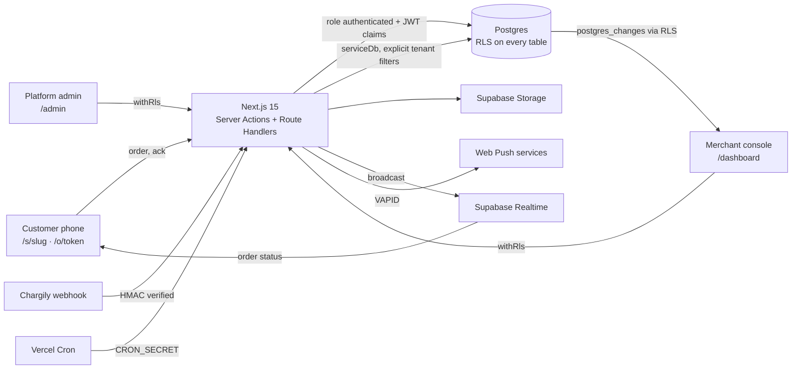

# Ranna · رنّة

Multi-tenant QR ordering for restaurants, cafés, food trucks and snack shops, with an "order ready" ring on the customer's own phone. Customers scan a QR code, order without installing anything, and their phone alerts them when the cashier taps **Ready**.

The working name lives in [`src/config/brand.ts`](src/config/brand.ts). Product context: [PRODUCT.md](PRODUCT.md) · plan: [PLAN.md](PLAN.md) · decisions: [DECISIONS.md](DECISIONS.md).

> Status: phases 1–4 of 10 done (foundation; billing; shop builder; QR codes). Try the demo shop at `/s/demo` after `npm run seed`. Sections marked _planned_ arrive in later phases.

## Quick start (about 10 minutes)

Prerequisites: Node.js 20.11+ (tested on 25), npm, and Docker Desktop running (for local Supabase).

```bash
npm install
```

```bash
npm run db:start
```

The first start downloads the Supabase images (a few minutes). Then create `.env.local` from the template and fill the Supabase keys printed by `npx supabase status` (see the table below):

```bash
cp .env.example .env.local
```

```bash
npm run db:reset
```

```bash
npm run seed
```

```bash
npm run dev
```

Open http://localhost:3000. Create a shop at `/signup`, or sign in as the seeded admin (`SEED_ADMIN_EMAIL` / `SEED_ADMIN_PASSWORD` from your `.env.local`). Local emails (magic links, confirmations) land in Mailpit at http://127.0.0.1:54324.

## Scripts

| Script                         | What it does                                                                  |
| ------------------------------ | ----------------------------------------------------------------------------- |
| `npm run dev`                  | Next.js dev server on :3000                                                   |
| `npm run check`                | Lint + type-check + all tests (unit and database)                             |
| `npm test`                     | Unit tests (no database needed)                                               |
| `npm run test:db`              | Tenant-isolation tests against the local Supabase database                    |
| `npm run db:start` / `db:stop` | Start/stop local Supabase (Docker)                                            |
| `npm run db:reset`             | Recreate the local database from `supabase/migrations`                        |
| `npm run db:generate`          | Generate a migration from the Drizzle schema                                  |
| `npm run seed`                 | Idempotent seed: plans, platform admin (demo shop and orders in later phases) |
| `npm run vapid`                | Print a new VAPID key pair for Web Push                                       |

## Environment variables

| Variable                                             | Required     | Where it comes from                                                                |
| ---------------------------------------------------- | ------------ | ---------------------------------------------------------------------------------- |
| `NEXT_PUBLIC_APP_URL`                                | yes          | Public base URL (QR codes and email links). `http://localhost:3000` locally        |
| `NEXT_PUBLIC_SUPABASE_URL`                           | yes          | `npx supabase status` → API URL, or the hosted project's URL                       |
| `NEXT_PUBLIC_SUPABASE_ANON_KEY`                      | yes          | `npx supabase status` → anon key (public by design; RLS protects data)             |
| `SUPABASE_SERVICE_ROLE_KEY`                          | yes          | Service role key. Server only, never exposed                                       |
| `DATABASE_URL`                                       | yes          | Postgres URL. Locally the direct URL; on Vercel the transaction pooler (port 6543) |
| `APP_SECRET`                                         | yes          | 32+ random bytes (`openssl rand -base64 32`). Salts IP/email hashes                |
| `NEXT_PUBLIC_VAPID_PUBLIC_KEY` / `VAPID_PRIVATE_KEY` | for push     | `npm run vapid`                                                                    |
| `VAPID_SUBJECT`                                      | for push     | `mailto:` contact for push services                                                |
| `PAYMENT_PROVIDERS`                                  | yes          | Enabled providers, comma-separated: `mock,manual,chargily`                         |
| `CHARGILY_MODE` / `CHARGILY_SECRET_KEY`              | for Chargily | Chargily Pay dashboard (test or live)                                              |
| `CRON_SECRET`                                        | prod         | Shared secret for the daily cron endpoint                                          |
| `MAILER`, `RESEND_API_KEY`, `MAIL_FROM`              | optional     | `log` prints emails to the server log; `resend` sends them                         |
| `SMS_PROVIDER`                                       | optional     | `mock` (real SMS/WhatsApp adapters plug in later)                                  |
| `SEED_ADMIN_EMAIL` / `SEED_ADMIN_PASSWORD`           | seed only    | The platform admin created by `npm run seed`                                       |

## Architecture



- **Tenant isolation is enforced by Postgres**, not only by code: merchant and staff requests run inside `withRls(userId, …)`, which switches to the `authenticated` role with the user's JWT claims. Column-level grants stop members changing billing state, totals or slugs directly. `anon` has no table access at all. See `tests/db/tenant-isolation.test.ts`.
- **Two root layouts**: `src/app/(site)` (public, always light, small message bundles for customer pages) and `src/app/(console)` (merchant + admin, light/dark).
- **i18n**: Arabic (default, RTL, no URL prefix), French `/fr`, English `/en`. Catalogs in `messages/`, kept in sync by a unit test.
- **Design system**: tokens in `src/app/globals.css`, with contrast checked by `tests/unit/tokens.test.ts`.

## Project layout

```
src/app/(site)/[locale]      public pages: landing, auth, (shop, order status: planned)
src/app/(console)/[locale]   merchant dashboard, platform admin, /start
src/app/auth/*               Supabase email-link and sign-out route handlers
src/lib/db                   Drizzle schema (+ RLS policies), client, withRls
src/lib/*                    domain logic: auth guards, merchants, money, rate limits, validation
supabase/migrations          SQL migrations (helpers → schema → security layer)
tests/unit · tests/db        Vitest suites
```

## Deployment _(planned: phase 10)_

## What alerts work where _(planned: phase 7)_
