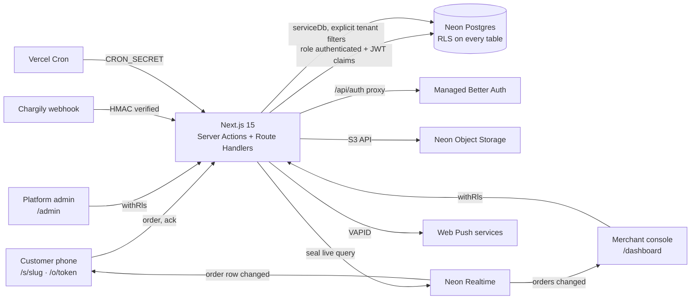

# Ranna · رنّة

Multi-tenant QR ordering for restaurants, cafés, food trucks and snack shops, with an "order ready" ring on the customer's own phone. Customers scan a QR code, order without installing anything, and their phone alerts them when the cashier taps **Ready**.

The working name lives in [`src/config/brand.ts`](src/config/brand.ts). Product context: [PRODUCT.md](PRODUCT.md) · plan: [PLAN.md](PLAN.md) · decisions: [DECISIONS.md](DECISIONS.md).

> Status: all 10 phases done (foundation; billing; shop builder; QR codes; ordering; order board and staff; ring system; Chargily Pay and daily jobs; marketing site; hardening), running on **Neon** (Postgres, Managed Better Auth, Object Storage, Realtime) and Vercel (D80). Run it locally in about 10 minutes (below); deploy with the Vercel + Neon steps further down.

## Quick start (about 10 minutes)

Prerequisites: Node.js 20.11+ (tested on 25), npm, Docker Desktop running (local Postgres for the tests), and a Neon project: Auth, Realtime and Object Storage have no local stand-in, so development runs against a **dev branch** of your Neon project (branches copy the database, auth users, buckets and Realtime settings; see [Deployment](#deployment-vercel--neon)).

```bash
npm install
```

Start the local Postgres and apply the migrations (used by `npm run test:db`):

```bash
npm run db:start
```

```bash
npm run db:migrate
```

Then write `.env.local`. Put the dev branch's values (`DATABASE_URL`, `NEON_AUTH_BASE_URL`, `NEON_REALTIME_URL`, `NEON_REALTIME_SECRET`, `S3_ENDPOINT`, `S3_REGION`, `S3_ACCESS_KEY_ID`, `S3_SECRET_ACCESS_KEY`) as `KEY=value` lines in any file and pass it; the script generates the app secret, cookie secret, cron secret, VAPID keys and seed passwords (it never overwrites an existing file):

```bash
npm run setup:env -- --from neon-dev.env
```

Apply the migrations to that branch, seed it, and start the app:

```bash
npm run db:migrate
```

```bash
npm run seed
```

```bash
npm run dev
```

Open http://localhost:3000. `npm run seed` creates a platform admin and a demo owner (their passwords are in `.env.local` as `SEED_ADMIN_PASSWORD` / `SEED_DEMO_PASSWORD`) and the demo shop at `/s/demo` with seven sample orders. (`db:migrate` uses `DATABASE_URL` from `.env.local`; the DB tests ignore it and always use the local Postgres.)

## Scripts

| Script                         | What it does                                                                               |
| ------------------------------ | ------------------------------------------------------------------------------------------ |
| `npm run dev`                  | Next.js dev server on :3000                                                                |
| `npm run check`                | Lint + type-check + all tests (unit and database)                                          |
| `npm test`                     | Unit tests (no database needed)                                                            |
| `npm run test:db`              | Tenant-isolation tests against the **local** Postgres (`TEST_DATABASE_URL` to override)    |
| `npm run db:start` / `db:stop` | Start/stop the local Postgres container (`ranna-pg`, port 54322)                           |
| `npm run db:migrate`           | Apply `db/migrations/*.sql` to `DATABASE_URL`, once each (tracked in `migrations.applied`) |
| `npm run db:reset`             | Recreate the local Postgres from `db/migrations` (local container only)                    |
| `npm run db:generate`          | Generate a migration from the Drizzle schema                                               |
| `npm run seed`                 | Idempotent seed: plans, platform admin, demo shop at `/s/demo` and 7 sample orders         |
| `npm run setup:env`            | Write `.env.local` from a Neon dev branch's values + generated secrets (never overwrites)  |
| `npm run test:e2e`             | Playwright: the full order → ready → ring loop and an axe WCAG 2.2 scan (needs seed)       |
| `npm run lighthouse`           | Lighthouse, mobile settings, against a production build (`npm run build && npm start`)     |
| `npm run vapid`                | Print a new VAPID key pair for Web Push                                                    |
| `npm run icons`                | Regenerate the app icons in `public/icons` from the brand mark                             |

## Environment variables

| Variable                                             | Required  | Where it comes from                                                                   |
| ---------------------------------------------------- | --------- | ------------------------------------------------------------------------------------- |
| `NEXT_PUBLIC_APP_URL`                                | yes       | Public base URL (QR codes and email links). `http://localhost:3000` locally           |
| `DATABASE_URL`                                       | yes       | Neon **pooled** connection string (host has `-pooler`), `?sslmode=require` only       |
| `NEON_AUTH_BASE_URL`                                 | yes       | Neon Console → Auth → Configuration (Managed Better Auth URL of the branch)           |
| `NEON_AUTH_COOKIE_SECRET`                            | yes       | 32+ random characters (`openssl rand -base64 32`). Signs the session cookie           |
| `APP_SECRET`                                         | yes       | 32+ random bytes (`openssl rand -base64 32`). Salts IP/email hashes                   |
| `S3_ENDPOINT` · `S3_REGION`                          | uploads   | Neon branch storage endpoint (`GET …/branches/{id}/storage`), region `us-east-1` etc. |
| `S3_ACCESS_KEY_ID` · `S3_SECRET_ACCESS_KEY`          | uploads   | A Neon credential with `storage:read` + `storage:write` (`token_id` and S3 secret)    |
| `NEXT_PUBLIC_ASSETS_URL`                             | uploads   | `<S3_ENDPOINT>/merchant-assets` (public bucket: logos, covers, dish photos)           |
| `NEON_REALTIME_URL` · `NEON_REALTIME_SECRET`         | live push | Neon Console → Realtime. Empty = pages poll instead (15 s; 1 s on the demo café)      |
| `NEXT_PUBLIC_REALTIME_URL`                           | live push | Same value as `NEON_REALTIME_URL`; the browser connects to it                         |
| `NEXT_PUBLIC_VAPID_PUBLIC_KEY` / `VAPID_PRIVATE_KEY` | for push  | `npm run vapid`                                                                       |
| `VAPID_SUBJECT`                                      | for push  | `mailto:` contact for push services                                                   |

## Architecture



- **Tenant isolation is enforced by Postgres**, not only by code: merchant and staff requests run inside `withRls(userId, …)`, which switches to the `authenticated` role and sets `request.jwt.claims`, read by `auth.uid()` in the policies. Column-level grants stop members changing billing state, totals or slugs directly. `anon` has no table access at all. See `tests/db/tenant-isolation.test.ts`. Platform prerequisites (the two roles, `auth.uid()`) are in `db/migrations/20261012000000_platform.sql`.
- **Auth** is Neon's Managed Better Auth, proxied under `/api/auth` so session cookies stay first-party (SameSite=Lax). Users live in `neon_auth."user"`; the app's `profiles` row appears on a user's first request, and the shop name a new owner typed at sign-up waits in `signup_intents` until their first visit.
- **Live updates** use Neon Realtime live SQL queries. The server seals a query for exactly what one page may see (one order for whoever holds its token; the shop's latest orders for a signed-in member), the browser subscribes, and a change triggers a normal re-read. Polling stays as the fallback (D5, D47, D80).
- **Two root layouts**: `src/app/(site)` (public, always light, small message bundles for customer pages) and `src/app/(console)` (merchant + admin, light/dark).
- **i18n**: Arabic (default, RTL, no URL prefix), French `/fr`, English `/en`. Catalogs in `messages/`, kept in sync by a unit test.
- **Design system**: tokens in `src/app/globals.css`, with contrast checked by `tests/unit/tokens.test.ts`.

## Project layout

```
src/app/(site)/[locale]      public pages: landing, auth, shop /s/<slug>, order status /o/<token>
src/app/(console)/[locale]   merchant dashboard, platform admin, /start
src/app/api/auth             Managed Better Auth proxy; src/app/auth/signout: sign-out
src/lib/db                   Drizzle schema (+ RLS policies), client, withRls
src/lib/auth · realtime · storage   Neon Auth session, live-query sealing/subscribing, S3 objects
src/lib/*                    domain logic: auth guards, merchants, money, rate limits, validation
db/migrations                SQL migrations (platform → helpers → schema → security layer → …)
scripts/migrate.ts           Migration runner (used by db:migrate, and for Neon)
tests/unit · tests/db        Vitest suites (tests/db needs the local Postgres)
tests/e2e                    Playwright: full loop + accessibility
public/sw.js                 Service worker: push notifications only, no caching
```

## Quality gates

- `npm run check`: lint, type-check, 250+ unit and database tests, including a schema-driven RLS guard (every table has RLS; no member reads another shop's rows; `anon` reads nothing).
- `npm run test:e2e`: a customer orders on a phone, the owner moves it on the board, the customer's page rings, the customer acknowledges, the board shows it; plus axe (WCAG 2.2 A/AA) on the public pages in all three languages, desktop and phone.
- `npm run lighthouse` (production build, mobile settings): shop page performance 93–95, accessibility, best practices and SEO 100.

## Deployment (Vercel + Neon)

**Live:** https://ranna-delta.vercel.app (Vercel project `ranna`; every push to `master` deploys). Neon project `ranna` (AWS us-east-1; branches `main` = production, `dev` = development).

1. **Neon project.** Create a project in a region that has Auth, Realtime and Object Storage (us-east-1, us-east-2, eu-central-1 or ap-southeast-1; pick the one nearest your customers and keep Vercel's function region next to it in `vercel.json`). Then, in the project:
   - **Enable Auth** on the branch (Managed Better Auth) and note its URL; add your site (`https://<your-domain>`) under **trusted domains**. Under **Settings → Better Auth**, turn on **Magic Link** (and set "Allow new user registration" as you like) and, for production, **Verify at sign-up** (email codes) and a custom email provider.
   - **Enable Realtime** on the branch (it needs **logical replication** on the project: Settings → Logical replication) and add your site origin to its allowed origins. Note `NEON_REALTIME_URL` and `NEON_REALTIME_SECRET`.
   - **Create two buckets**: `merchant-assets` (public read) and `receipts` (private), and a credential with `storage:read` and `storage:write`.
   - Apply the migrations **after** enabling Auth (the schema references `neon_auth."user"`):

     ```bash
     DATABASE_URL="<pooled url>" npm run db:migrate
     ```

2. **Vercel project.** Import the GitHub repository (framework: Next.js; `vercel.json` sets the region `iad1`, next to the us-east-1 database, and the daily cron). Add the environment variables from the table above for Production:
   - `NEXT_PUBLIC_APP_URL` = your domain (QR codes print this URL: set it before printing).
   - `DATABASE_URL` = the **pooled** connection string with `?sslmode=require` and nothing else.
   - `NEON_AUTH_BASE_URL`, `NEON_AUTH_COOKIE_SECRET`, `S3_*`, `NEXT_PUBLIC_ASSETS_URL`, and for live push `NEON_REALTIME_URL`, `NEON_REALTIME_SECRET`, `NEXT_PUBLIC_REALTIME_URL`.
   - `APP_SECRET`, `CRON_SECRET`: new random values (`openssl rand -base64 32`), different from local ones.
   - `NEXT_PUBLIC_VAPID_PUBLIC_KEY`, `VAPID_PRIVATE_KEY` from `npm run vapid`, and `VAPID_SUBJECT=mailto:<your support address>`.
   - `PAYMENT_PROVIDERS=chargily,manual` (never `mock` in production), `CHARGILY_MODE`, `CHARGILY_SECRET_KEY`.
   - `MAILER=resend`, `RESEND_API_KEY`, `MAIL_FROM`.

3. **Chargily.** In the Chargily Pay dashboard, use the key matching `CHARGILY_MODE`. Checkouts send their own webhook URL (`https://<your-domain>/api/webhooks/chargily`); you can also register it in Developers Corner. Make one test-mode payment first: the docs don't state whether `amount` is in dinars or centimes, and we send whole dinars (DECISIONS D62).

4. **Seed plans and an admin** against the production branch, from your machine, with the production `DATABASE_URL`, `NEON_AUTH_BASE_URL`, `NEXT_PUBLIC_APP_URL` (your domain, which must be a trusted origin) and `SEED_ADMIN_*` in the environment, and `SEED_DEMO=false` unless you want the public demo café in production. Accounts are created through the auth service's sign-up endpoint, so the admin can sign in with the seeded password:

   ```bash
   npm run seed
   ```

5. **Check:** open `/`, create a shop, pay, add a dish, print a QR code, order from your phone, tap Ready. Confirm the cron in Vercel → Settings → Cron Jobs, and that `GET /api/cron/daily` without the secret answers 401.

Before launch: replace the bracketed operator details in the Terms and Privacy pages (`messages/*.json`, keys `legal.*`) and have them reviewed; confirm plan prices in **Admin → Plans**.

## What alerts work where

When the counter taps **Ready**, the customer is told through every channel their phone allows. This is what each phone can actually do; the order page tells the customer which case applies to them.

| Customer's phone and browser                                             | Page open, screen on                               | Page in background / screen off                               | Page closed                      |
| ------------------------------------------------------------------------ | -------------------------------------------------- | ------------------------------------------------------------- | -------------------------------- |
| Android, Chrome / Samsung Internet / Firefox                             | Full-screen alert, looping sound, vibration        | Push notification with vibration (after "Ring my phone")      | Push notification                |
| iPhone, Safari tab (iOS 16.4+)                                           | Full-screen alert; sound after one tap on the page | No push from a Safari tab: nothing until the page is reopened | Nothing (no push from a tab)     |
| iPhone, added to Home Screen (iOS 16.4+)                                 | Full-screen alert, sound                           | Push notification                                             | Push notification                |
| iPhone before iOS 16.4                                                   | Full-screen alert; sound after one tap             | Nothing                                                       | Nothing                          |
| Desktop Chrome / Edge / Firefox / Safari 16+                             | Full-screen alert, sound                           | Push notification                                             | Push only while the browser runs |
| Notifications denied, or in-app browsers (Instagram, Facebook, WhatsApp) | Full-screen alert, sound                           | Nothing                                                       | Nothing                          |

- **Fallback:** if no push got through and the shop enabled it in Settings, an SMS/WhatsApp is sent to the customer's phone number (optional field). v1 ships a mock adapter that sends nothing and records the attempt as skipped; plug a real provider into `src/lib/notify/messaging.ts`.
- **Vibration** is not available on iPhone in any browser. **Sound** in a background tab depends on the browser and is not relied on.
- **Keeping the screen on** while waiting uses the Screen Wake Lock API (Chrome/Android, Safari 16.4+); elsewhere the page asks the customer to keep it open.
- Staff can **Ring again** (every 30 s, up to 6 times); the counter and the call-out screen remain the last resort.
