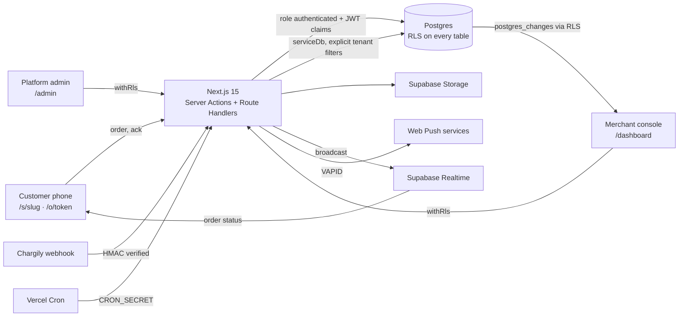

# Ranna · رنّة

Multi-tenant QR ordering for restaurants, cafés, food trucks and snack shops, with an "order ready" ring on the customer's own phone. Customers scan a QR code, order without installing anything, and their phone alerts them when the cashier taps **Ready**.

The working name lives in [`src/config/brand.ts`](src/config/brand.ts). Product context: [PRODUCT.md](PRODUCT.md) · plan: [PLAN.md](PLAN.md) · decisions: [DECISIONS.md](DECISIONS.md).

> Status: all 10 phases done (foundation; billing; shop builder; QR codes; ordering; order board and staff; ring system; Chargily Pay and daily jobs; marketing site; hardening). Run it locally in about 10 minutes (below); deploy with the Vercel + Supabase steps further down.

## Quick start (about 10 minutes)

Prerequisites: Node.js 20.11+ (tested on 25), npm, and Docker Desktop running (for local Supabase).

```bash
npm install
```

```bash
npm run db:start
```

The first start downloads the Supabase images (a few minutes). Then write `.env.local` in one step: it reads the local Supabase keys and generates the app secret, cron secret, VAPID keys and seed passwords (it never overwrites an existing file):

```bash
npm run setup:env
```

```bash
npm run db:reset
```

```bash
npm run seed
```

```bash
npm run dev
```

Open http://localhost:3000. Create a shop at `/signup`, or sign in as the demo café's owner (`SEED_DEMO_EMAIL` / `SEED_DEMO_PASSWORD`) or the platform admin (`SEED_ADMIN_EMAIL` / `SEED_ADMIN_PASSWORD`), all in your `.env.local`. Local emails (magic links, confirmations, staff invitations) land in Mailpit at http://127.0.0.1:54324, or in the server log when `MAILER=log`.

**Try the whole loop in two windows:** order from the demo café at http://localhost:3000/s/demo on your phone or a narrow window and tap "Ring my phone"; on the board at http://localhost:3000/dashboard/orders (as the demo owner) tap Start, then Ready. The customer page takes over in green and rings. Demo-café orders also move to Ready by themselves after about a minute.

## Scripts

| Script                         | What it does                                                                           |
| ------------------------------ | -------------------------------------------------------------------------------------- |
| `npm run dev`                  | Next.js dev server on :3000                                                            |
| `npm run check`                | Lint + type-check + all tests (unit and database)                                      |
| `npm test`                     | Unit tests (no database needed)                                                        |
| `npm run test:db`              | Tenant-isolation tests against the local Supabase database                             |
| `npm run db:start` / `db:stop` | Start/stop local Supabase (Docker)                                                     |
| `npm run db:reset`             | Recreate the local database from `supabase/migrations`                                 |
| `npm run db:generate`          | Generate a migration from the Drizzle schema                                           |
| `npm run seed`                 | Idempotent seed: plans, platform admin, demo shop at `/s/demo` and 7 sample orders     |
| `npm run setup:env`            | Write `.env.local` from local Supabase + generated secrets (never overwrites)          |
| `npm run test:e2e`             | Playwright: the full order → ready → ring loop and an axe WCAG 2.2 scan (needs seed)   |
| `npm run lighthouse`           | Lighthouse, mobile settings, against a production build (`npm run build && npm start`) |
| `npm run vapid`                | Print a new VAPID key pair for Web Push                                                |
| `npm run icons`                | Regenerate the app icons in `public/icons` from the brand mark                         |

## Environment variables

| Variable                                             | Required     | Where it comes from                                                                |
| ---------------------------------------------------- | ------------ | ---------------------------------------------------------------------------------- |
| `NEXT_PUBLIC_APP_URL`                                | yes          | Public base URL (QR codes and email links). `http://localhost:3000` locally        |
| `NEXT_PUBLIC_SUPABASE_URL`                           | yes          | `npx supabase status` → API URL, or the hosted project's URL                       |
| `NEXT_PUBLIC_SUPABASE_ANON_KEY`                      | yes          | `npx supabase status` → anon key (public by design; RLS protects data)             |
| `SUPABASE_SERVICE_ROLE_KEY`                          | yes          | Service role key. Server only, never exposed                                       |
| `DATABASE_URL`                                       | yes          | Postgres URL. Locally the direct URL; on Vercel the transaction pooler (port 6543) |
| `APP_SECRET`                                         | yes          | 32+ random bytes (`openssl rand -base64 32`). Salts IP/email hashes                |
| `NEXT_PUBLIC_VAPID_PUBLIC_KEY` / `VAPID_PRIVATE_KEY` | for push     | `npm run vapid`                                                                    |
| `VAPID_SUBJECT`                                      | for push     | `mailto:` contact for push services                                                |
| `PAYMENT_PROVIDERS`                                  | yes          | Enabled providers, comma-separated: `mock,manual,chargily`                         |
| `CHARGILY_MODE` / `CHARGILY_SECRET_KEY`              | for Chargily | Chargily Pay dashboard (test or live)                                              |
| `CRON_SECRET`                                        | prod         | Shared secret for the daily cron endpoint                                          |
| `MAILER`, `RESEND_API_KEY`, `MAIL_FROM`              | optional     | `log` prints emails to the server log; `resend` sends them                         |
| `SMS_PROVIDER`                                       | optional     | `mock` (real SMS/WhatsApp adapters plug in later)                                  |
| `SEED_ADMIN_EMAIL` / `SEED_ADMIN_PASSWORD`           | seed only    | The platform admin created by `npm run seed`                                       |
| `SEED_DEMO_EMAIL` / `SEED_DEMO_PASSWORD`             | seed only    | The demo café's owner (also used by the end-to-end tests)                          |

## Architecture



- **Tenant isolation is enforced by Postgres**, not only by code: merchant and staff requests run inside `withRls(userId, …)`, which switches to the `authenticated` role with the user's JWT claims. Column-level grants stop members changing billing state, totals or slugs directly. `anon` has no table access at all. See `tests/db/tenant-isolation.test.ts`.
- **Two root layouts**: `src/app/(site)` (public, always light, small message bundles for customer pages) and `src/app/(console)` (merchant + admin, light/dark).
- **i18n**: Arabic (default, RTL, no URL prefix), French `/fr`, English `/en`. Catalogs in `messages/`, kept in sync by a unit test.
- **Design system**: tokens in `src/app/globals.css`, with contrast checked by `tests/unit/tokens.test.ts`.

## Project layout

```
src/app/(site)/[locale]      public pages: landing, auth, shop /s/<slug>, order status /o/<token>
src/app/(console)/[locale]   merchant dashboard, platform admin, /start
src/app/auth/*               Supabase email-link and sign-out route handlers
src/lib/db                   Drizzle schema (+ RLS policies), client, withRls
src/lib/*                    domain logic: auth guards, merchants, money, rate limits, validation
supabase/migrations          SQL migrations (helpers → schema → security layer)
tests/unit · tests/db        Vitest suites (tests/db needs local Supabase)
tests/e2e                    Playwright: full loop + accessibility
public/sw.js                 Service worker: push notifications only, no caching
```

## Quality gates

- `npm run check`: lint, type-check, 250+ unit and database tests, including a schema-driven RLS guard (every table has RLS; no member reads another shop's rows; `anon` reads nothing).
- `npm run test:e2e`: a customer orders on a phone, the owner moves it on the board, the customer's page rings live, the customer acknowledges, the board shows it; plus axe (WCAG 2.2 A/AA) on the public pages in all three languages, desktop and phone.
- `npm run lighthouse` (production build, mobile settings): shop page performance 93–95, accessibility, best practices and SEO 100.

## Deployment (Vercel + Supabase)

1. **Supabase project.** Create a project (region near your customers, e.g. Frankfurt or Paris for Algeria). Then from this folder:

   ```bash
   npx supabase link --project-ref <your-project-ref>
   ```

   ```bash
   npx supabase db push
   ```

   This applies every migration in `supabase/migrations` (schema, RLS, grants, storage buckets, realtime publication). In **Authentication → URL configuration**, set the Site URL to your domain and add `https://<your-domain>/**` to the redirect URLs. In **Authentication → Email templates**, paste `supabase/templates/confirmation.html` and `supabase/templates/magic-link.html` (they link to `/auth/confirm` with a `token_hash`, so links work across devices). Configure a custom SMTP sender for production volume.

2. **Vercel project.** Import the GitHub repository (framework: Next.js; `vercel.json` already sets the Paris region `cdg1` and the daily cron). Add the environment variables from the table above for Production:
   - `NEXT_PUBLIC_APP_URL` = your domain (QR codes print this URL: set it before printing).
   - `NEXT_PUBLIC_SUPABASE_URL`, `NEXT_PUBLIC_SUPABASE_ANON_KEY`, `SUPABASE_SERVICE_ROLE_KEY` from **Project settings → API**.
   - `DATABASE_URL` = the **transaction pooler** connection string (port 6543) from **Project settings → Database**.
   - `APP_SECRET`, `CRON_SECRET`: new random values (`openssl rand -base64 32`), different from local ones.
   - `NEXT_PUBLIC_VAPID_PUBLIC_KEY`, `VAPID_PRIVATE_KEY` from `npm run vapid`, and `VAPID_SUBJECT=mailto:<your support address>`.
   - `PAYMENT_PROVIDERS=chargily,manual` (never `mock` in production), `CHARGILY_MODE`, `CHARGILY_SECRET_KEY`.
   - `MAILER=resend`, `RESEND_API_KEY`, `MAIL_FROM`.

3. **Chargily.** In the Chargily Pay dashboard, use the key matching `CHARGILY_MODE`. Checkouts send their own webhook URL (`https://<your-domain>/api/webhooks/chargily`); you can also register it in Developers Corner. Make one test-mode payment first: the docs don't state whether `amount` is in dinars or centimes, and we send whole dinars (DECISIONS D62).

4. **Seed plans and an admin** against the hosted database, from your machine with the production `DATABASE_URL`, `SUPABASE_*` and `SEED_ADMIN_*` in a temporary env file, and `SEED_DEMO=false` unless you want the public demo café in production:

   ```bash
   npm run seed
   ```

5. **Check:** open `/`, create a shop, pay, add a dish, print a QR code, order from your phone, tap Ready. Confirm the cron in Vercel → Settings → Cron Jobs, and that `GET /api/cron/daily` without the secret answers 401.

Before launch: replace the bracketed operator details in the Terms and Privacy pages (`messages/*.json`, keys `legal.*`) and have them reviewed; confirm plan prices in **Admin → Plans**.

## What alerts work where

When the counter taps **Ready**, the customer is told through every channel their phone allows. This is what each phone can actually do; the order page tells the customer which case applies to them.

| Customer's phone and browser                                             | Page open, screen on                               | Page in background / screen off                               | Page closed                      |
| ------------------------------------------------------------------------ | -------------------------------------------------- | ------------------------------------------------------------- | -------------------------------- |
| Android, Chrome / Samsung Internet / Firefox                             | Full-screen alert, looping sound, vibration        | Push notification with vibration (after "Ring my phone")      | Push notification                |
| iPhone, Safari tab (iOS 16.4+)                                           | Full-screen alert; sound after one tap on the page | No push from a Safari tab: nothing until the page is reopened | Nothing (no push from a tab)     |
| iPhone, added to Home Screen (iOS 16.4+)                                 | Full-screen alert, sound                           | Push notification                                             | Push notification                |
| iPhone before iOS 16.4                                                   | Full-screen alert; sound after one tap             | Nothing                                                       | Nothing                          |
| Desktop Chrome / Edge / Firefox / Safari 16+                             | Full-screen alert, sound                           | Push notification                                             | Push only while the browser runs |
| Notifications denied, or in-app browsers (Instagram, Facebook, WhatsApp) | Full-screen alert, sound                           | Nothing                                                       | Nothing                          |

- **Fallback:** if no push got through and the shop enabled it in Settings, an SMS/WhatsApp is sent to the customer's phone number (optional field). v1 ships a mock adapter that sends nothing and records the attempt as skipped; plug a real provider into `src/lib/notify/messaging.ts`.
- **Vibration** is not available on iPhone in any browser. **Sound** in a background tab depends on the browser and is not relied on.
- **Keeping the screen on** while waiting uses the Screen Wake Lock API (Chrome/Android, Safari 16.4+); elsewhere the page asks the customer to keep it open.
- Staff can **Ring again** (every 30 s, up to 6 times); the counter and the call-out screen remain the last resort.
